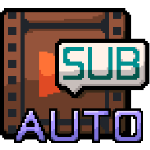

<p align="center">
  
</p>

# GUI For SMI Auto Downloader

[](https://github.com/dhku/GUI-for-SMI-Auto-Downloader/releases)


자막을 원클릭으로 쉽게 다운로드 받을 수 있는 프로그램입니다.

[Download GUI For SMI Auto Downloader](https://github.com/dhku/GUI-for-SMI-Auto-Downloader/releases)

[Non-GUI Version Github (For NAS)](https://github.com/dhku/SMI-Auto-Downloader) 

## 기능

* 이번 분기 편성표, 작품 검색, 최신 자막 목록 (애니시아)
* 자막 다운로드 (네이버 블로그, 티스토리, 블로그스팟, 구글 드라이브, WinPNG)
* 즐겨찾기 작품 일괄 다운로드와 주기 반복 다운로드 지원
* AI 자막 번역 및 변환 지원  (jimaku.cc)
* 백그라운드 시스템 트레이 지원
* 다운로드 및 AI 자막 번역 로깅 지원
* 크로스 플랫폼 지원 (Windows/macOS)

## 안내

* 해당 프로그램은 자막을 편리하게 다운받기 위해 제작되었으나, 자막을 올려 주시는 분의 블로그에도 관심과 응원을 부탁드립니다.
* 다운로드 링크가 URL로 제공되지 않거나 CloudFlare Captcha 인증이 필요한 블로그는 지원하지 않습니다.
* 한 번 받은 회차는 해당 폴더에 `finish.txt`가 생겨 다음 실행에서 건너뜁니다.
* 닫기 버튼은 프로그램을 시스템 트레이에 최소화합니다. 프로그램을 끝내려면 트레이 메뉴의 **종료**를 누릅니다. 트레이 아이콘이나 macOS Dock을 누르면 창이 다시 열립니다.

## 사용 방법

### 1. 편성표


* 요일 버튼으로 이번 분기 편성표를 봅니다. **外**는 기타, **新**은 신작 목록입니다.
* 작품을 클릭하면 왼쪽 **자막 정보**가 열립니다.
* 제목의 **On-AIR**를 누르면 오늘 요일로 이동한 뒤, 시작한 지 30분 이내인 작품을 붉게 표시합니다. 그 시각에 방영 중인 작품이 없으면 다음 방송 예정인 작품을 표시합니다. 화면을 클릭하면 표시가 사라집니다.

### 2. 자막 정보


* **즉시 자막 다운로드**는 선택한 작품의 자막만 받습니다.
* **작품 즐겨찾기에 추가**는 다운로드 관리 목록과 `anime.yml`에 작품을 넣고 바로 저장합니다.
* **애니 웹사이트**는 작품 공식 사이트를, **더 보기**는 애니시아 작품 페이지를 엽니다.
* 회차 버튼을 누르면 해당 자막 제작자의 글이 열립니다.
* 작품 제목을 클릭하면 제목이 클립보드에 복사됩니다.

### 3. 다운로드 관리


* 처음 실행하면 자막은 프로그램 폴더의 `downloads`에 저장됩니다.
* **경로 변경**으로 저장 폴더를 바꿀 수 있고, **다운 폴더 열기**로 그 폴더를 엽니다. 경로를 바꾸면 `settings.yml`의 `auto-download-path`가 `false`가 되어 다음 실행에도 그 폴더를 유지합니다. `true`로 되돌리면 다시 `downloads`를 사용합니다.
* 즐겨찾기에서 작품을 빼려면 해당 작품의 행을 고른 뒤 **선택행삭제**를 누르고 **저장 하기**를 누릅니다. **모든행삭제**도 저장해야 `anime.yml`에 반영됩니다. **리로드**는 저장하지 않은 표 수정을 버리고 파일을 다시 읽습니다.
* **다운로드 시작**은 즐겨찾기 작품을 한 번 받습니다. **주기적으로 반복 실행**을 켜면 10분, 30분, 1시간, 3시간, 6시간, 12시간, 24시간 중 하나를 고르고 **스케줄러 시작**으로 반복합니다.

### 4. 작품 검색


* 제목으로 작품을 검색합니다. 목록 끝까지 내리면 다음 결과가 이어집니다.
* 검색어를 입력하면 애니시아 자동완성 후보가 입력창 툴팁에 표시됩니다.
* 결과를 클릭하면 **자막 정보**가 열립니다.

### 5. 최신 자막


* 최근 올라온 자막 목록입니다. 아래로 내리면 다음 목록이 이어집니다.
* 한 번 클릭하면 **자막 정보**가 열리고, 두 번 클릭하면 자막 제작자의 글로 이동합니다.

### 6. AI 자막


편성표, 검색, 최신 자막, 다운로드 관리에서 작품을 고른 뒤 이 화면을 열면 그 작품의 일본어 원제가 자동으로 검색창에 들어갑니다. 직접 찾을 때는 일본어 원제나 영어 제목을 입력합니다.

* **일본어**는 원본 파일만 받고, **한국어**는 원본을 받은 뒤 번역해 저장합니다. 원본이 이미 있으면 번역만 진행합니다.
* 파일은 `downloads/AI 자막`에 저장됩니다. 번역본은 이름 뒤에 `.ko`가 붙습니다. `ep01.ass`는 `ep01.ko.ass`가 됩니다.
* 지원 형식은 SRT, ASS, SSA, SMI, VTT, TXT입니다. zip은 안의 자막 파일을 풀어 저장합니다.
* 체크한 파일은 **일괄 다운로드**로 함께 받습니다. 표 머리의 `선택` 칸을 누르면 전체를 선택하거나 해제합니다.
* 받은 파일의 버튼은 **완료**로 바뀌고, 누르면 저장 폴더가 열립니다.
* 번역 중인 버튼을 다시 누르면 번역이 취소됩니다. 진행 내용은 **로그** 화면에 실시간으로 쌓입니다.

한국어 번역은 기본으로 꺼져 있습니다. `settings.yml`의 `ai-translate.active`를 사용할 제공자로 바꾸고, 그 제공자의 `api_key`와 `model`을 적습니다. 준비된 제공자는 OpenAI와 Gemini입니다. OpenAI 호환 API는 `providers`에 이름, `api_key`, `model`, `base_url`을 추가한 뒤 `active`에 그 이름을 적으면 사용할 수 있습니다.

```yaml
ai-translate:
  active: openai          # none 이면 번역을 하지 않습니다
  concurrency: 3          # 동시에 보낼 요청 수. 429가 나면 줄입니다
  glossary: true          # 작품별 용어집. false 면 용어집을 쓰지 않습니다
  item_batch: 200         # API한 요청에 넣을 대사 수 (기본값: 200줄)
  providers:
    openai:
      api_key: ""
      model: gpt-5.5
      base_url: "https://api.openai.com/v1"
```

* 용어집은 `downloads/AI 자막/용어집`에 작품별 yml로 저장되고, 다음 화를 번역할 때 이어서 사용됩니다. 
* 말투와 번역 원칙은 `prompt.yml`에서 바꿉니다. 저장한 내용은 다음 번역부터 적용됩니다. 항목을 비우면 그 항목만 기본 문구를 쓰고, 파일을 지우면 기본 내용으로 다시 만듭니다. 출력 JSON 형식 설명은 그대로 두는 편이 안전합니다.
* API 키는 `settings.yml`에서 입력하실 수 있습니다.

### 7. 로그


* 다운로드 로그와 AI 번역 로그를 최대 30개까지 보관합니다. 더 늘어나면 오래된 파일부터 지웁니다.
* 작업을 고르면 오른쪽에서 내용을 볼 수 있고, 받는 동안 콘솔에 진행 상황이 갱신됩니다.

### 8. 화면 배율


* `auto-dpi`가 `true`이면 Windows는 시스템 DPI를 따르고, macOS는 Qt가 화면 배율을 처리합니다.
* 직접 지정하려면 `auto-dpi`를 `false`로 하고 `dpi`를 바꿉니다. 자주 쓰는 값은 96(100%), 120(125%), 144(150%), 192(200%)입니다. 바꾼 뒤에는 프로그램을 다시 실행합니다.

## 빌드

일반 사용은 [Releases](https://github.com/dhku/GUI-for-SMI-Auto-Downloader/releases)의 실행 파일을 받으면 됩니다. 릴리즈 전의 최신 빌드를 받으려면 아래의 명령어를 사용합니다.

Windows

```shell
python setup.py build
```

macOS

```shell
python3 setup.py bdist_mac
```
